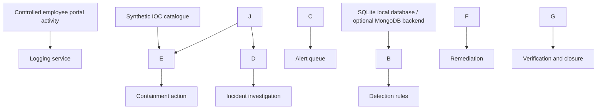

# CyberShield — SOC Threat Intelligence \& Incident Response Management Portal

**Academic research project · Defensive security simulation · Local lab only**

CyberShield is a web-based learning prototype for demonstrating a simplified Security Operations Center (SOC) workflow. It combines a SOC console with a controlled employee-facing portal so that simulated security events can be logged, detected, investigated, contained, remediated, verified, and closed.

> \*\*Safety and scope:\*\* CyberShield is an academic demonstration environment, not a production SIEM, SOAR platform, WAF, or enterprise identity system. Run it locally on `127.0.0.1` and use only synthetic or authorized test data. Do not expose it to the public internet. The employee portal contains intentional attack-simulation scenarios; it is not designed as a real employee application.

## Project goals

* Demonstrate how application events can feed a centralized logging and detection workflow.
* Model a basic SOC alert-to-incident lifecycle.
* Show investigation notes, evidence, remediation, verification, and an audit trail.
* Demonstrate indicator-of-compromise (IOC) lookups using a small synthetic indicator dataset.
* Practice role separation, password hashing, CSRF-protected form submissions, and safe rendering of simulated attack inputs.

## Current capabilities

* SOC dashboard with counts based on stored records.
* Centralized event logs and simulated detection for events such as repeated authentication failures, SQL-injection-like input, and XSS-like input.
* Alert review and linked incident cases.
* Incident lifecycle: `NEW → INVESTIGATING → CONTAINED → RESOLVED → CLOSED`, with evidence gates for key transitions.
* Incident findings, containment actions, remediation notes, verification records, and action history.
* Asset inventory and a local synthetic IOC catalogue.
* Separate SOC and employee-portal sessions with role checks.
* CSRF protection for state-changing forms and password hashing for seeded demo users.
* A deliberately simulated employee-facing portal for controlled demonstrations; the application records and flags example input instead of using it as raw SQL or executing supplied XSS payloads.

## Architecture overview



## Technology stack

* Python and Flask
* Jinja templates, HTML, CSS, and JavaScript
* SQLite for the default local setup
* Optional MongoDB backend
* Werkzeug password hashing
* Flask-WTF CSRF protection

## Project structure

```text
cybershield-soc-portal/
├── app.py
├── auth.py
├── config.py
├── database.py
├── detection.py
├── incident\_response.py
├── logging\_service.py
├── threat\_intel.py
├── init\_mongodb.py
├── verify\_project.py
├── requirements.txt
├── .env.example
├── run.ps1
├── static/
└── templates/
```

Local configuration, local database files, virtual environments, and Python cache files are deliberately excluded from this repository.

## Run locally (Windows PowerShell)

Python 3.11 or a compatible supported Python 3 version is recommended.

1. Clone the repository and enter its directory:

```powershell
   git clone https://github.com/shettysanket06/cybershield-soc-portal.git
   cd cybershield-soc-portal
   ```

2. Create and activate a virtual environment:

```powershell
   py -m venv .venv
   .\\.venv\\Scripts\\Activate.ps1
   ```

3. Install dependencies:

```powershell
   python -m pip install --upgrade pip
   pip install -r requirements.txt
   ```

4. Set a local development secret for this session and use SQLite:

```powershell
   $env:CYBERSHIELD\_DB\_BACKEND = "sqlite"
   $env:CYBERSHIELD\_SECRET\_KEY = (python -c "import secrets; print(secrets.token\_hex(32))")
   ```

5. Start the application:

```powershell
   python app.py
   ```

6. Open these local addresses:

   * SOC console: `http://127.0.0.1:5000/login`
   * Employee portal: `http://127.0.0.1:5000/portal`

The SQLite database is created and seeded locally at first run. It is not tracked by Git.

### Demo-only accounts

For a fresh local lab, the current code seeds sample accounts such as `admin`, `analyst`, and `john` with the default passwords visible in `config.py` and the local demo documentation. These are **public, deliberately weak demo credentials**. Use them only in an isolated local lab, change them for any private demonstration, and never expose this application to an untrusted network.

## Controlled demonstration scenarios

Only perform these actions against your own local instance.

### 1\. Brute-force-style login event

1. Open the local employee portal.
2. Use the built-in simulation and generate repeated incorrect login attempts for a test account.
3. Open the SOC console and review the associated logs and alerts.
4. Record what evidence the alert contains and what additional evidence would be useful.

### 2\. SQL-injection-pattern simulation

1. Use the employee directory search in the local controlled portal.
2. Submit a harmless training string that matches the app's detection patterns.
3. Review the generated event/alert and record the detection evidence.
4. Explain why the simulation is not a real-world penetration test and what a production application should do defensively.

### 3\. XSS-pattern simulation

1. Use the feedback form in the local portal.
2. Submit a benign XSS-pattern test string in the controlled lab.
3. Confirm that the event is logged and that the payload is escaped when rendered.
4. Record the observed behaviour and limitations.

## Verification

The repository includes a structural and optional functional verification script.

```powershell
python verify\_project.py
```

* The structural checks validate that key source files exist, Python files parse, template references resolve, and POST forms include CSRF tokens.
* If dependencies are installed, the script also runs local Flask-client checks for login/role separation, simulated detection, the incident lifecycle, and related behaviours.
* The script may create a local database during functional testing. Local database files are ignored by Git.

**Validation status:** This source package has been prepared for public repository hygiene. Run the verification command on your machine and record the actual result before claiming that the application has passed functional tests. No results should be claimed unless you personally run and verify them.

## Security notes

* Never commit `.env`, real connection strings, passwords, tokens, private keys, or personal data.
* Use `.env.example` as a reference only. Replace placeholders before use.
* The optional MongoDB connection string must remain private. Error messages in the repository are written to avoid printing the full URI.
* Keep the app bound to `127.0.0.1`; do not deploy this teaching prototype as-is.
* The demo accounts and simulated attacks are not production controls.

## Research and learning value

This project is intended to support learning and discussion around event logging, detection logic, triage, IOC enrichment, incident state management, response evidence, and analyst documentation. Its value is in the code, controlled demonstrations, and documented limitations—not a claim that it replaces an enterprise SOC platform.

## Author

**Sanket Shetty** — BSc IT student focused on defensive cybersecurity, SOC operations, incident response, and threat intelligence.

* LinkedIn: https://www.linkedin.com/in/sanket-shetty-467008329/
* GitHub: https://github.com/shettysanket06


\---


\## Application Screenshots


\### 1. SOC Dashboard


The SOC dashboard provides an overview of the simulated security operations environment.


!\[CyberShield SOC Dashboard](docs/screenshots/Dashboard.png)


\### 2. Incident Management


The incident management interface demonstrates the workflow for reviewing and managing security incidents.


!\[CyberShield Incident Management](docs/screenshots/Incident-management.png)


\### 3. Employee Portal


The employee portal provides a controlled interface for simulating security-related activities within the demonstration environment.


!\[CyberShield Employee Portal](docs/screenshots/employee-portal.png)


